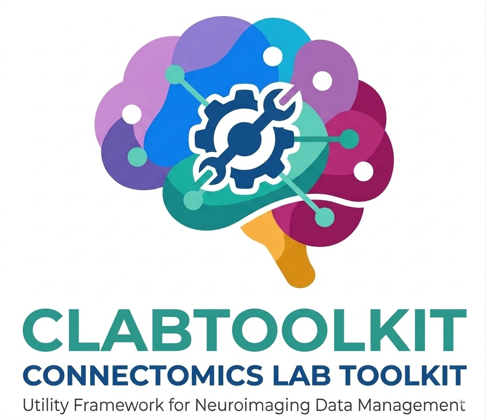
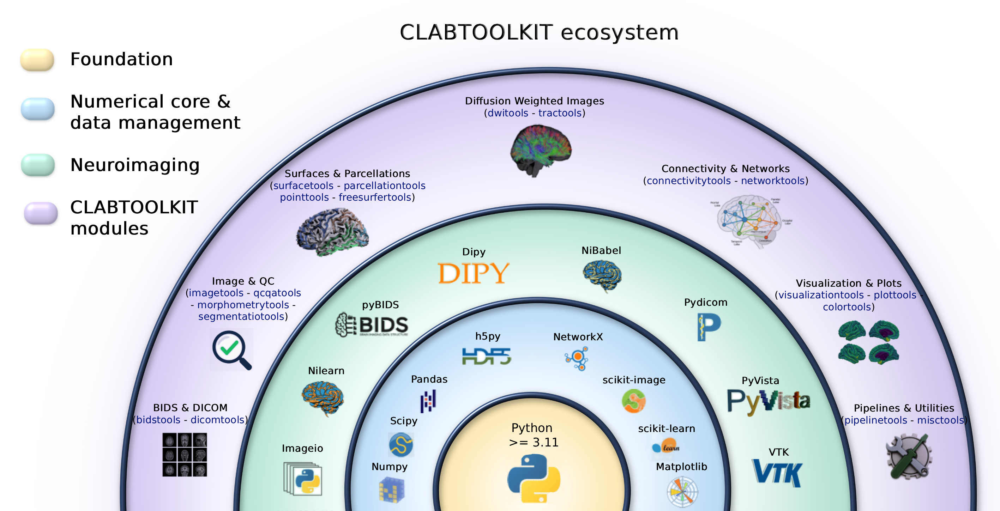

========================
Connectomics Lab Toolkit
========================

.. image:: https://img.shields.io/pypi/v/clabtoolkit.svg
        :target: https://pypi.python.org/pypi/clabtoolkit

.. image:: https://github.com/connectomicslab/clabtoolkit/actions/workflows/ci.yml/badge.svg
        :target: https://github.com/connectomicslab/clabtoolkit/actions/workflows/ci.yml

.. image:: https://readthedocs.org/projects/clabtoolkit/badge/?version=latest
        :target: https://clabtoolkit.readthedocs.io/en/latest/?version=latest
        :alt: Documentation Status

.. image:: https://img.shields.io/pypi/pyversions/clabtoolkit.svg
        :target: https://pypi.python.org/pypi/clabtoolkit

.. image:: https://codecov.io/gh/connectomicslab/clabtoolkit/branch/main/graph/badge.svg
        :target: https://codecov.io/gh/connectomicslab/clabtoolkit

.. image:: https://zenodo.org/badge/DOI/10.5281/zenodo.23540587.svg
        :target: https://doi.org/10.5281/zenodo.23540587
        :alt: Zenodo DOI

A comprehensive Python toolkit for neuroimaging data processing and analysis, specifically designed for working with brain connectivity data, BIDS datasets, and various neuroimaging formats.

* **Free software**: Apache Software License 2.0
* **Documentation**: https://clabtoolkit.readthedocs.io
* **Source Code**: https://github.com/connectomicslab/clabtoolkit
* **Python versions**: 3.11+

Installation
------------

Install from PyPI::

    pip install clabtoolkit

For development installation::

    git clone https://github.com/connectomicslab/clabtoolkit.git
    cd clabtoolkit
    pip install -e .[dev]

Requirements and optional dependencies:

* Python 3.11 or newer.
* 3D plotting (``visualizationtools``) uses PyVista and needs either a display or off-screen
  rendering (for example ``PYVISTA_OFF_SCREEN=true`` on a server).
* FreeSurfer is **not** required. If it is installed and ``FREESURFER_HOME`` is set, the example
  notebooks use its sample subjects; otherwise they run on simulated data.

Features
--------

Each module has a notebook in ``usage_examples`` (``examples-<module>-methods.ipynb``)
with runnable examples.

**Data organization**

* **BIDS Tools** (``clabtoolkit.bidstools``): entity extraction and editing in BIDS filenames,
  BIDS tree generation and validation, derivatives discovery.
* **DICOM Tools** (``clabtoolkit.dicomtools``): DICOM organization, compression and metadata extraction.
* **Pipeline Tools** (``clabtoolkit.pipelinetools``): processing-status tables and inventories of
  derivatives, with JSON and SQLite export.

**Images and diffusion**

* **Image Tools** (``clabtoolkit.imagetools``): voxel/world conversions, cropping, morphology,
  interpolation, 4D volume handling and image simulation.
* **DWI Tools** (``clabtoolkit.dwitools``): volume removal by index or b-value, B0 extraction,
  acquisition schemes from bvec/bval files, q-space visualization and tensor-derived maps (FA, MD, AD, RD).
* **Tract Tools** (``clabtoolkit.tracttools``): the ``Tractogram`` class, with streamline filtering,
  resampling, image interpolation along streamlines, merging and TRK/TCK conversion.
* **Segmentation Tools** (``clabtoolkit.segmentationtools``): atlas-based parcellation and tissue
  segmentation tables.

**Surfaces and parcellations**

* **Surface Tools** (``clabtoolkit.surfacetools``): the ``Surface`` class, with scalar maps, annotations,
  volume-to-surface mapping, smoothing and export.
* **Parcellation Tools** (``clabtoolkit.parcellationtools``): the ``Parcellation`` class, with region
  selection by name or code, centroids, volumes, region-wise time series and functional connectivity.
* **FreeSurfer Tools** (``clabtoolkit.freesurfertools``): FreeSurfer subjects, annotations, statistics
  tables and transforms.
* **Morphometry Tools** (``clabtoolkit.morphometrytools``): region-wise area, volume and Euler number,
  and parsing of FreeSurfer statistics.
* **Point Tools** (``clabtoolkit.pointstools``): point clouds, merging and curve smoothing.

**Connectivity and networks**

* **Connectivity Tools** (``clabtoolkit.connectivitytools``): the ``Connectome`` class, with thresholding,
  graph metrics, matrix plotting, 3D visualization and CSV/HDF5 I/O.
* **Network Tools** (``clabtoolkit.networktools``): sparse-matrix conversion and connected components.

**Visualization and utilities**

* **Visualization Tools** (``clabtoolkit.visualizationtools``): ``BrainPlotter`` for surfaces, tractograms
  and volumes, multi-view layouts and carpet plots.
* **Plot Tools** (``clabtoolkit.plottools``): figure layout and font helpers for the plotting classes.
* **Colors Tools** (``clabtoolkit.colorstools``): color validation, RGB/hex conversion and color tables.
* **Quality Control Tools** (``clabtoolkit.qcqatools``): slice generation and HTML pages for visual quality control.
* **Misc Tools** (``clabtoolkit.misctools``): condition-based selection and general-purpose helpers.

Quick Start
-----------

The examples below are self-contained: they use simulated data, so you can run them as they are.
More examples for every module are available in the ``usage_examples`` folder
(see ``usage_examples/clabtoolkit_examples.ipynb``).

**Filter a parcellation by region name** (``keep_by_name``)

.. code-block:: python

    import clabtoolkit.parcellationtools as cltparc

    # Simulate a parcellation with 10 regions and name them
    parc = cltparc.Parcellation.simulate_parcellation(n_regions=10, seed=42)
    parc.set_names(['ctx-rh-precentral', 'ctx-lh-precentral', 'ctx-rh-postcentral', 'ctx-lh-postcentral',
                    'ctx-rh-superiorfrontal', 'ctx-lh-superiorfrontal', 'ctx-rh-supramarginal',
                    'ctx-lh-supramarginal', 'subc-rh-amygdala', 'subc-lh-amygdala'])

    # Keep only the precentral regions (the object is modified in place)
    parc.keep_by_name(['ctx-rh-precentral', 'ctx-lh-precentral'])
    print(parc.name)  # ['ctx-rh-precentral', 'ctx-lh-precentral']

To load your own parcellation, use ``cltparc.Parcellation("parc.nii.gz", color_table="lut.txt")``.

**Sample an image along the streamlines of a tractogram** (``interpolate_on_tractogram``)

.. code-block:: python

    import clabtoolkit.imagetools as cltimg
    import clabtoolkit.tracttools as clttract

    # Simulate a reference image and a tractogram with 5 bundles
    cltimg.simulate_image(reference=(100, 100, 70), simulated_image="/tmp/image.nii.gz")
    tract = clttract.Tractogram.simulate_tractogram(ref_image="/tmp/image.nii.gz")

    # Sample the image at every point of every streamline
    tract.interpolate_on_tractogram("/tmp/image.nii.gz", map_name="fa",
                                    storage_mode="data_per_point", interp_method="linear")

    print(tract.list_maps()["maps_per_point"])  # ['fa']
    print(tract.data_per_point["fa"][0][:5])    # values along the first streamline

Use ``storage_mode="data_per_streamline"`` with ``reduction="mean"`` to store a single value per streamline.

**Plot a surface with a scalar map** (``BrainPlotter``)

.. code-block:: python

    import clabtoolkit.surfacetools as cltsurf
    import clabtoolkit.visualizationtools as cltvis

    # Simulate a surface and a thickness map
    surf = cltsurf.Surface.simulate_surface(seed=42, shape="sphere")
    surf.simulate_map(map_name="thickness")

    # Plot two views of the map and save the figure
    plotter = cltvis.BrainPlotter()
    plotter.plot(objs2plot=surf, views=["lateral", "medial"], map_names="thickness",
                 colormaps="viridis", colorbar=True, save_path="/tmp/thickness.png")

To plot your own data, load a surface with ``cltsurf.Surface("lh.pial")`` and its map with
``surf.load_scalar_maps("lh.thickness", maps_names="thickness")``.

Contributing
------------

Contributions are welcome! Please open an issue first to discuss major changes. See
`CONTRIBUTING.rst <CONTRIBUTING.rst>`_ for the full guidelines.

Testing
-------

Run tests with::

    pytest

Run tests with coverage::

    pytest --cov=clabtoolkit

Changelog
---------

See `HISTORY.rst <HISTORY.rst>`_ for a detailed changelog.

Citing
------

If you use clabtoolkit in your work, please cite the toolkit paper::

    Alemán-Gómez, Y., et al. clabtoolkit. arXiv:2607.02638.
    https://arxiv.org/abs/2607.02638

The repository includes a ``CITATION.cff`` file, so GitHub shows a "Cite this repository" option
with the same reference. Every release is archived in Zenodo: the DOI
`10.5281/zenodo.23540587 <https://doi.org/10.5281/zenodo.23540587>`_ always points to the latest
version, and each version has its own DOI listed on that page. The source code is available at
https://github.com/connectomicslab/clabtoolkit.

Credits
-------

Developed by Yasser Alemán-Gómez and collaborators at the Connectomics Lab. See
`AUTHORS.rst <AUTHORS.rst>`_ for the full list.
